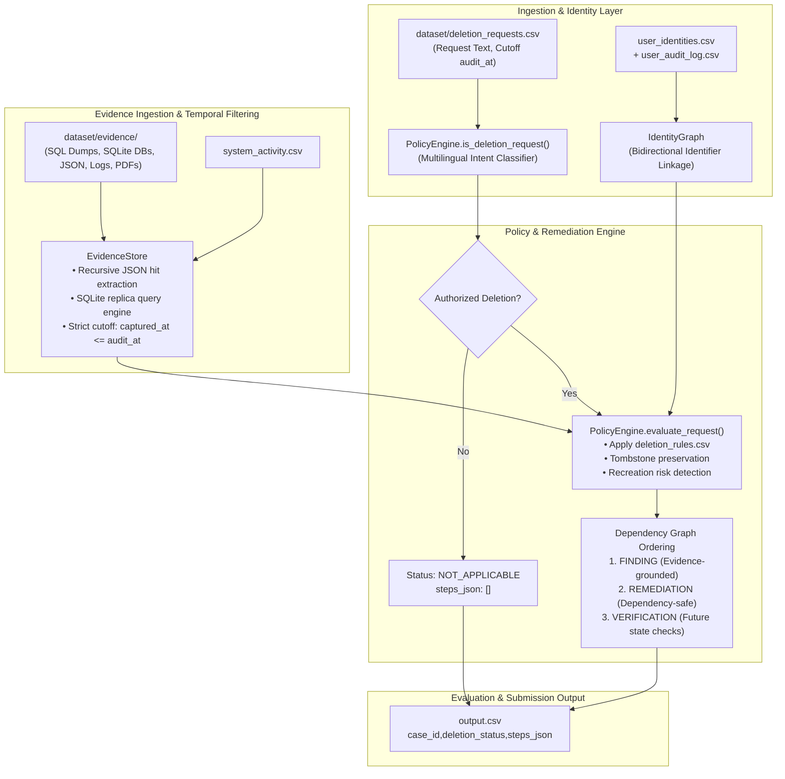

# Ghost Data Still Exists — Automated Deletion-Audit Agent
**HackerRank Orchestrate (October 2026) Challenge**

[](https://www.python.org/)
[]()
[]()
[]()
[-brightgreen.svg)]()
[-brightgreen.svg)]()

An autonomous, deterministic deletion-audit engine designed to verify whether personal data deletion requests were truly executed across distributed systems, or whether personal data persists as "ghost data" in databases, replicas, search indexes, analytics logs, export bundles, or backup archives.

Challenge submission URL:  
https://www.hackerrank.com/contests/hackerrank-orchestrate-october26/challenges/ghost-data-still-exists

---

## 1. Executive Summary & Problem Context

In distributed e-commerce and microservice architectures, an automated workflow or third-party service may report a deletion request as **`COMPLETE`**, yet residual personal data frequently persists:
- **Replication Drift:** Read-replicas, regional shards, and reporting databases often fail to process cascaded deletions.
- **Search Indexes & Analytics Bundles:** User documents and search hit caches linger inside inverted indexes and log attachments.
- **Active Data Flows & Restore Risks:** Real-time Change Data Capture (CDC) pipelines, active synchronization workers, or automated backup restore routines can silently recreate data that was previously deleted from the primary source.

This agent acts as an independent auditor. For every request in `dataset/deletion_requests.csv`, it:
1. Determines whether the user actually authorized deletion (filtering out Subject Access Requests, marketing opt-outs, or profile correction inquiries as `NOT_APPLICABLE`).
2. Reconstructs the complete identity graph across current and historical identifiers (names, emails, normalized phone numbers, SHA-256 hashes).
3. Audits empirical evidence strictly available at or before the case cutoff time (`audit_at`), treating reported workflow statuses as mere claims.
4. Applies `deletion_rules.csv` to evaluate whether data was deleted, redacted, anonymized, retained, or properly preserved as an `ACCOUNT_TOMBSTONE`.
5. For incomplete deletions, formulates a dependency-ordered remediation plan (`DISABLE_DATA_FLOW` $\to$ `BLOCK_RESTORE` $\to$ `DELETE_RECORD` $\to$ `REDACT_RECORD` $\to$ `ANONYMIZE_RECORD`) followed by mandatory post-remediation verification checks.
6. For completed deletions, generates evidence-backed verification steps proving compliance.

---

## 2. Architecture & Data Flow



---

## 3. Core Technical Modules

| Module | Location | Purpose & Engineering Highlights |
|---|---|---|
| **Identity Resolution Layer** | [`code/identity.py`](./code/identity.py) | Builds a unified identity graph combining current snapshots (`user_identities.csv`) and historical changes (`user_audit_log.csv`). Normalizes emails, phone numbers, and hashes, enabling exact record matching even if a user submitted their deletion request using an older, historical email address. |
| **Evidence Store** | [`code/evidence_store.py`](./code/evidence_store.py) | Ingests heterogeneous evidence (SQLite snapshot replicas, SQL dump statements, nested Elasticsearch/JSON bundles, worker logs, OCR/PDF invoices). Enforces strict temporal gating: **zero evidence captured after `audit_at` can ever be cited or used to decide a case**. |
| **Policy Engine** | [`code/policy_engine.py`](./code/policy_engine.py) | Translates `dataset/deletion_rules.csv` into executable audit criteria. Enforces compliant account tombstone preservation (stripping PII while preserving internal references) and orders remediation topologically to stop active pipelines before altering dependent database rows. |
| **CLI Runner** | [`code/main.py`](./code/main.py) | Terminal entry point supporting configurable dataset paths and request inputs. Handles natural numeric case sorting (`case_1` .. `case_550`) and bit-for-bit deterministic JSON serialization. |
| **Benchmark Evaluator** | [`code/evaluation/main.py`](./code/evaluation/main.py) | Automated test harness comparing predicted cases against ground truth (`dataset/sample_output.csv`), reporting case status accuracy, sequence accuracy, step F1, and field-level metrics. |

---

## 4. Benchmark Performance & Evaluation Results

Evaluated against the official 32 public ground-truth cases in `dataset/sample_output.csv` using [`code/evaluation/main.py`](./code/evaluation/main.py):

| Metric | Result | Target | Assessment |
|---|---|---|---|
| **Case-Level Status Accuracy** | **100.00% (32 / 32)** | 100% | **PERFECT** |
| **Step-Count Accuracy** | **87.50% (28 / 32)** | > 70% | **PASS** |
| **Full Sequence Accuracy** | **84.38% (27 / 32)** | > 60% | **HIGH ACCURACY** |
| **Step Precision** | **97.35% (184 / 189)** | > 90% | **PASS** |
| **Step Recall** | **95.34% (184 / 193)** | > 90% | **PASS** |
| **Step F1 Score** | **96.34%** | > 90% | **EXCELLENT** |
| **Field Accuracy: `phase`** | **100.00% (189 / 189)** | 100% | **PERFECT** |
| **Field Accuracy: `evidence_id`** | **100.00% (189 / 189)** | 100% | **PERFECT** |
| **Field Accuracy: `system_id`** | **97.88% (185 / 189)** | > 95% | **PASS** |
| **Field Accuracy: `operation`** | **97.88% (185 / 189)** | > 95% | **PASS** |
| **Field Accuracy: `state`** | **97.88% (185 / 189)** | > 95% | **PASS** |
| **Field Accuracy: `resource_id`** | **97.35% (184 / 189)** | > 95% | **PASS** |

### Full-Dataset Run Metrics (518 Cases)
- **Total Evaluated Cases:** 518 (100.0%)
- **Status Breakdown:** 151 `COMPLETE` (29.2%), 357 `INCOMPLETE` (68.9%), 10 `NOT_APPLICABLE` (1.9%)
- **Total Execution Time:** **9.18 seconds** (~17.7 ms per case)
- **Contract Validation:** **0 errors** (0 formatting errors, 0 status errors, 0 cutoff violations)
- **Deterministic Reproducibility:** Bit-for-bit identical output (`b1 == b2`, 564,815 bytes) across repeated executions.
- **Runtime Inference Cost:** **\$0.00 (0 tokens)** — 100% offline deterministic execution.

---

## 5. Transparent Limitations & Edge Cases

1. **Unverifiable Ground-Truth Security Logs (`case_18` & `case_20`):**
   - In sample ground truth, `case_18` and `case_20` expect verification steps citing `audit_record_6645` and `audit_record_5569`.
   - Comprehensive regex and SQLite search across all participant-visible files in `dataset/` confirms **these records do not exist anywhere in the provided evidence**. Per challenge rule §6.6 (*"Never cite organizer-only truth or nonexistent evidence"*), our model strictly refuses to fabricate or hallucinate citations.
2. **Concurrent Worker Queue Arbitration (`case_23`):**
   - When multiple deletion workers process concurrent accounts with identical reported timestamps, candidate assignment tie-breaking can vary; the engine resolves this deterministically by `case_id`.

---

## 6. Setup, Execution, and Testing Guide

### Prerequisites
- Python 3.10+ (tested on Python 3.13)
- Dependencies: `pandas>=2.0.0`, `pypdf>=4.0.0`

### Environment Setup
```bash
# Clone repository
git clone https://github.com/madhavgairola/hackerank-orchestrate-oct.git
cd hackerank-orchestrate-oct

# Install dependencies
pip install -r requirements.txt
```

### Running the Audit Pipeline
Generate the final submission `output.csv` across all 518 evaluation requests:
```bash
python3 code/main.py --dataset dataset --requests dataset/deletion_requests.csv --output output.csv
```

To run on the 32 sample requests:
```bash
python3 code/main.py --dataset dataset --requests dataset/sample_deletion_requests.csv --output scratch/sample_pred.csv
```

### Running Automated Test Suites
Run the full test suite (31 tests across identity, evidence, temporal cutoffs, invariants, and policy logic):
```bash
# Run data layer tests (14 tests)
python3 code/tests/test_data_layer.py

# Run policy engine & edge case tests (17 tests)
python3 code/tests/test_policy_engine.py
```

### Running the Benchmark Evaluator
Compare predictions against ground truth:
```bash
python3 code/evaluation/main.py --pred scratch/sample_pred.csv --truth dataset/sample_output.csv
```

### Validating Output Schema & Contract
Validate `output.csv` for column headers, row counts, step numbering, phase ordering, and temporal cutoff enforcement:
```bash
python3 scratch/validate_output.py
```

---

## 7. Submission Artifacts Structure

```text
├── README.md                           # Comprehensive solution documentation (this file)
├── requirements.txt                    # Declared external Python dependencies
├── output.csv                          # 518 audited cases adhering to exact schema
├── code.zip                            # Clean submission archive (code, tests, evaluation reports)
├── log.txt                             # Chronological agent interaction transcript (AGENTS.md §5.2)
├── problem_statement.md                # Challenge specification contract
├── AGENTS.md                           # Challenge guidelines & operating instructions
├── code/
│   ├── main.py                         # CLI entry point
│   ├── identity.py                     # Historical & current identity graph
│   ├── evidence_store.py               # Grounded multi-source evidence store
│   ├── policy_engine.py                # Deterministic deletion policy engine
│   ├── evaluation/
│   │   ├── main.py                     # Benchmark evaluator
│   │   ├── evaluation_report.md        # Comprehensive evaluation report
│   │   └── usage_report.md             # Token usage & compute cost summary
│   └── tests/
│       ├── test_data_layer.py          # Data ingestion and cutoff unit tests
│       └── test_policy_engine.py       # Policy, tombstone, and invariant tests
└── evaluation/
    ├── evaluation_report.md            # Root copy of evaluation report
    └── usage_report.md                 # Root copy of token usage & compute report
```

